# Practica icc-est-u1-Ordenamiento de estudiantes

## Integrantes
-Paul Illescas

-Ariel Tigre

# 1. Analisis solicitado
- El resultado negativo de "compareTo" indica que el objeto actual debe ubicarse antes que el otro; cero indica igualdad según el criterio comparado; positivo indica que debe ubicarse después.
- En C3, comparar solo por nota devuelve cero para estudiantes con códigos distintos porque la nota es el único criterio pero los objetos siguen siendo diferentes.
- Invertir un comparador invierte también sus desempates. En C4 se invierte únicamente el criterio de nota antes de agregar el nombre ordenado ascendente. En C5 se invierte únicamente el comparador del nombre, conservando la edad de forma ascendente.
- C3 demuestra estabilidad cuando los estudiantes con nota 8.5 conservan el orden de entrada: E014, E007, E005, E008 y E010.

# 2. Resultados y evidencias

## Programacion de escenarios
Codigo C1, C2, C2
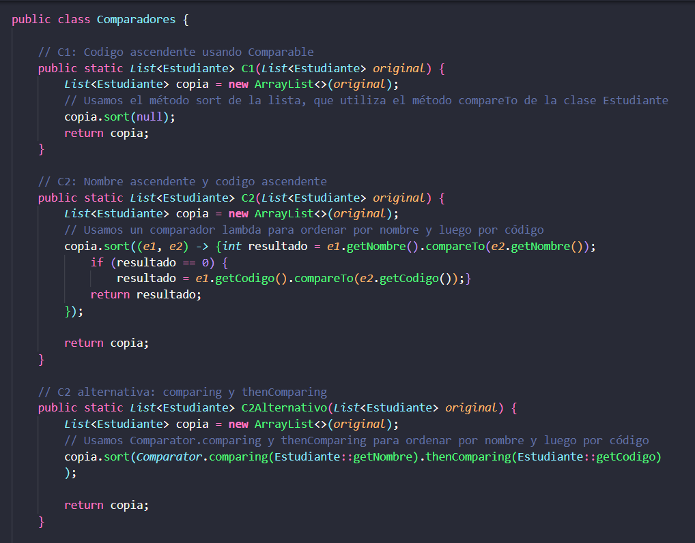 
Codigo C3, C4, C5
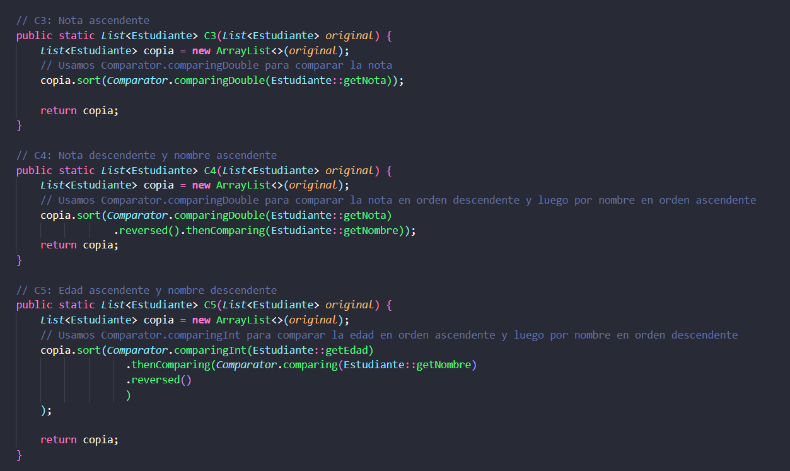
Codigo C6, c7
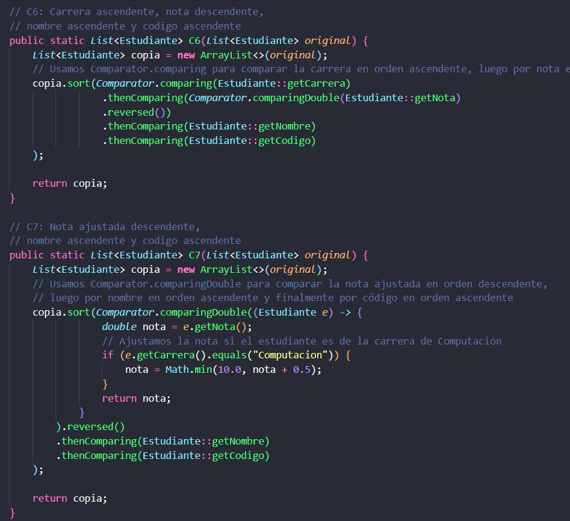

## Consola
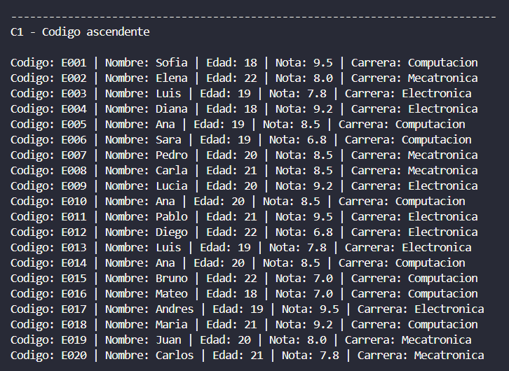
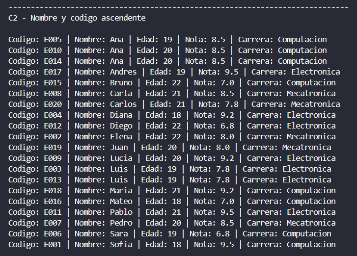
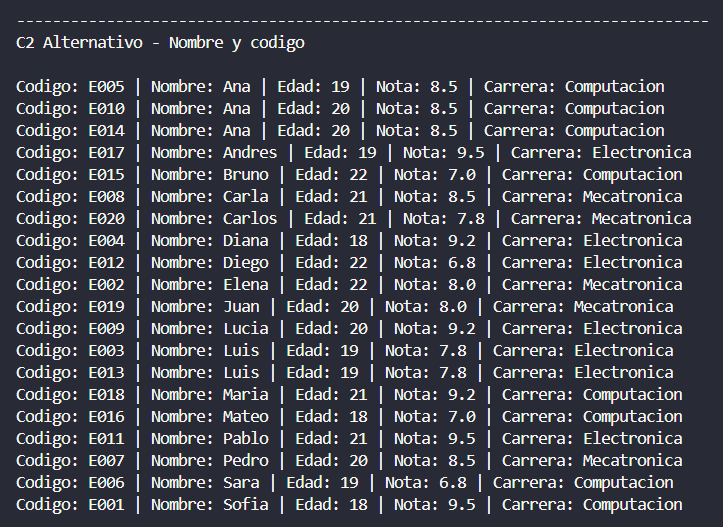
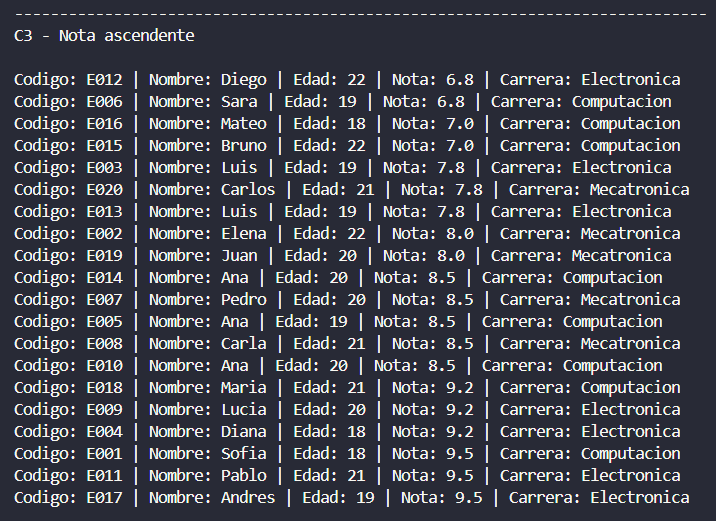
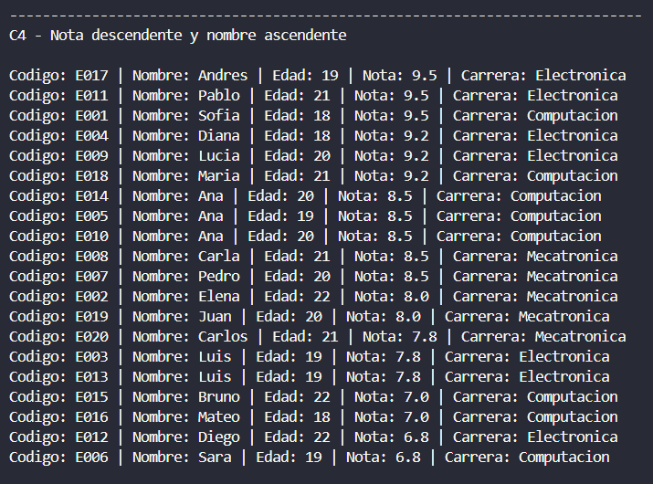
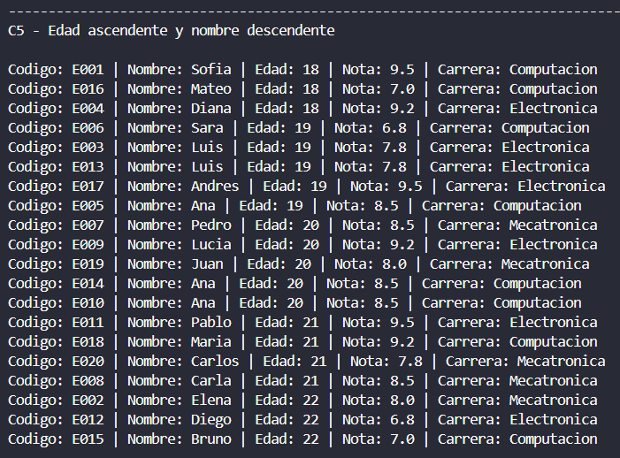
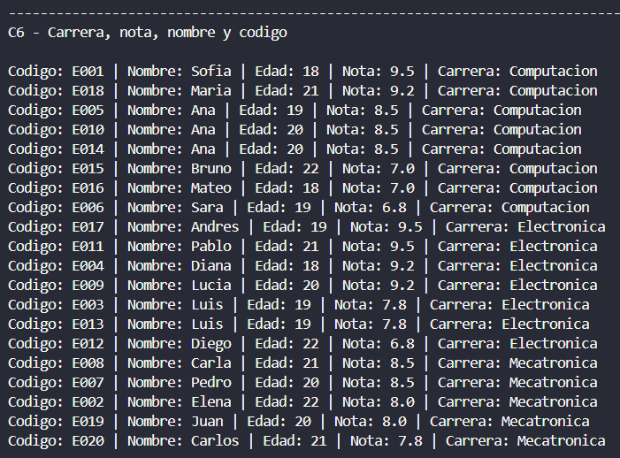
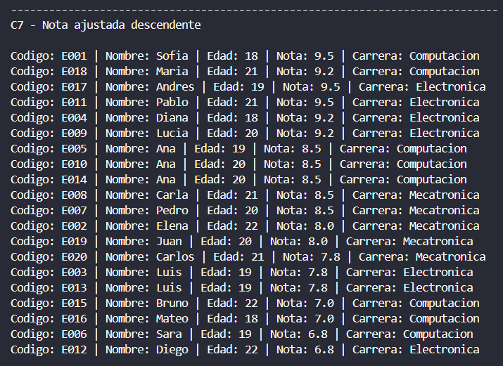
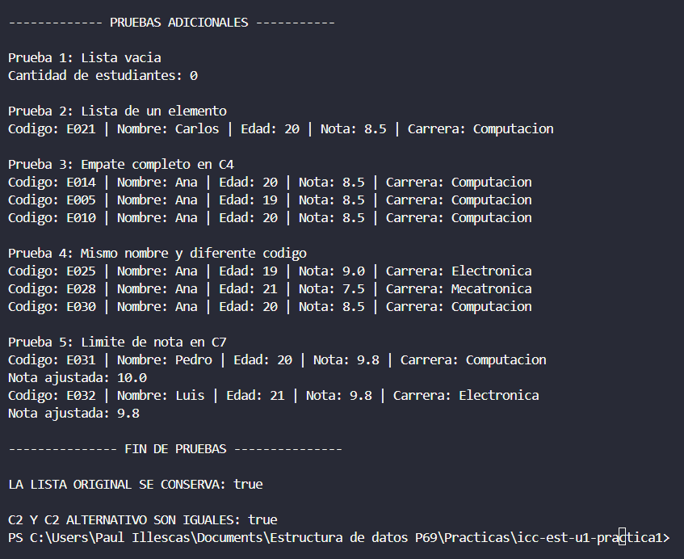

# 3. Pruebas y casos de aceptación

Realizamos las pruebas a las consultas C1–C7 utilizando los 20 registros proporcionados. También se verificó la equivalencia entre las dos implementaciones de C2 y la conservación de la lista original.

| Escenario | Resultado esperado | Resultado obtenido | Estado |
|---|---|---|---|
| C1 con 20 registros | E001, E002, ..., E020, en ese orden. | Los 20 códigos aparecen ordenados ascendentemente. | Aprobado |
| C2 con 20 registros | Los primeros registros son E005, E010, E014 y E017. | Se obtuvo la secuencia inicial esperada. | Aprobado |
| C3: estudiantes con nota 8.5 | E014, E007, E005, E008 y E010. Se conserva su orden relativo original. | Los cinco estudiantes aparecen en el orden solicitado. | Aprobado |
| C4 con 20 registros | Los primeros registros son E017, E011 y E001. | Se obtuvo el orden esperado. | Aprobado |
| C5 con 20 registros | Los primeros registros son E001, E016 y E004. | Se obtuvo el orden esperado. | Aprobado |
| C6 con 20 registros | Los primeros registros son E001, E018, E005, E010 y E014. | Se obtuvo el orden esperado. | Aprobado |
| C7 con 20 registros | E001 tiene nota ajustada 10.0 y ocupa el primer lugar. E018 tiene 9.7 y ocupa el segundo. | Se obtuvieron las posiciones esperadas y se conservaron las notas originales. | Aprobado |
| Equivalencia de C2 | Las dos implementaciones producen exactamente la misma secuencia. | La comparación mostró el resultado true. | Aprobado |
| Lista vacía | Se procesa sin errores y conserva su contenido. | La cantidad de estudiantes obtenida fue 0. | Aprobado |
| Lista de un elemento | Se procesa sin errores y conserva su contenido. | Se conservó el estudiante E021 con todos sus atributos. | Aprobado |
| C4 con E014, E005 y E010 | Se conserva E014, E005 y E010, porque coinciden en nota y nombre. | Los tres estudiantes conservaron su orden original. | Aprobado |
| Lista original después de todas las consultas | Mantiene los 20 códigos en la secuencia proporcionada inicialmente. | La comprobación mostró el resultado true. | Aprobado |
| Prueba propia 1: mismo nombre y diferentes códigos | Ordenar por nombre ascendente y código ascendente. | Se obtuvo E025, E028 y E030. | Aprobado |
| Prueba propia 2: límite de nota en C7 | La nota ajustada no debe superar 10.0. | E031 conserva su nota original 9.8 y obtiene una nota ajustada de 10.0. E032 conserva su nota de 9.8. | Aprobado |

# 4. Conclusiones personales

Vimos diferentes maneras de ordenar los objetos con Comparable se establece el orden natural de los estudiantes utilizando sus códigos, mientras que con Comparator pude realizar otros ordenamientos, como por nombre, edad y nota. Asi vimos que se pueden utilizar diferentes criterios sin tener que modificar el orden natural de la clase Estudiante.

Al realizar las consultas pudimos ver como funciona un desempate y lo quede suceder segun lo que establezcamos. Por ejemplo, en C4 primero se ordenaron las notas de mayor a menor y, cuando varios estudiantes tenían la misma nota, se utilizó el nombre en orden ascendente. También entendimos que es importante aplicar reversed() para no invertir criterios que deben mantenerse ascendentes.

Con las pruebas realizadas comprobamos la importancia de trabajar con copias de la lista original para no cambiar la lista original. En C3 observé que los estudiantes que tenían la misma nota conservaron su orden inicial de la lista original, mientras que en C7 se calculó una nota ajustada para hacer el ordenamiento sin modificar las notas originales. Eso verifica que las consultas pueden ejecutarse sin tocar o modificar los datos iniciales.

